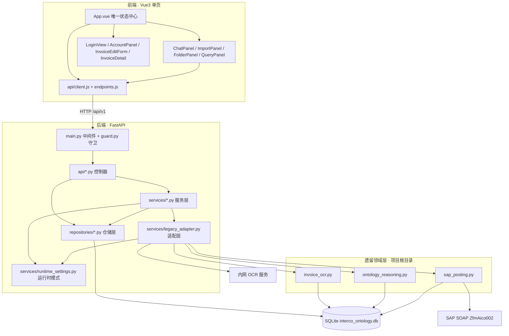
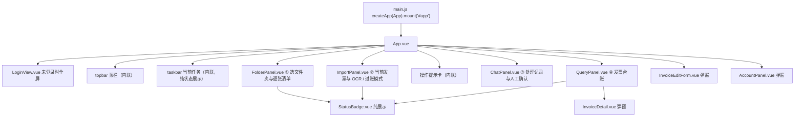
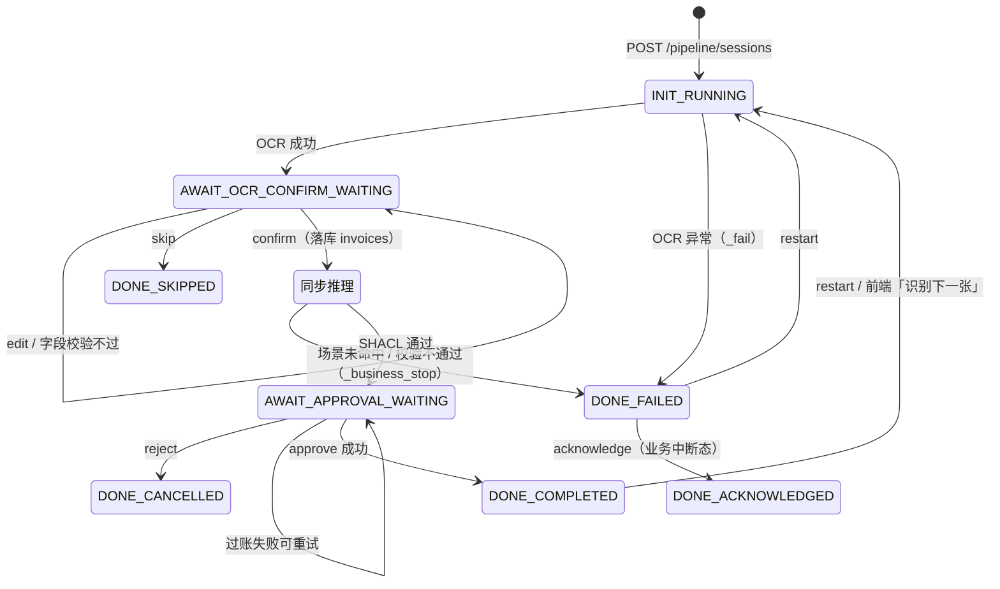

# 关联交易发票识别及 SAP 过账平台 · 代码架构与调用关系说明

> 文档版本：2026-11-13　|　适用代码：`D:\workbuddy\qddev` 当前工作区
> 代码规模：后端 `backend/app/**/*.py` 约 3,867 行（45 个模块），前端 `frontend/src/**` 约 2,872 行（14 个文件），
> 另有三个遗留领域脚本 `invoice_ocr.py` / `ontology_reasoning.py` / `sap_posting.py`。
> 本文只描述代码实际结构，不含任何 `.env` 密钥值、账号密码或令牌。

---

## 0. 一分钟速读

这个系统是「**一个 Vue3 单页界面 + 一个 FastAPI 分层后端 + 三个原有 CLI 脚本**」拼起来的。
最关键的理解是：**业务规则没有重写**，全在三个遗留脚本里；后端新写的 `services/legacy_adapter.py`
是唯一的桥，把它们包装成可以被 HTTP 会话反复调用的函数。

```
浏览器（Vue3 单页）
   │ HTTP /api/v1/*（JWT + HttpOnly 刷新 Cookie）
   ▼
FastAPI 控制器 api/*.py  →  服务层 services/*.py  →  仓储层 repositories/*.py
                                  │
                                  ├─ legacy_adapter.py（唯一适配层）
                                  │      ├─ invoice_ocr.py        OCR / 落库 / 场景匹配
                                  │      ├─ ontology_reasoning.py 本体推理 / SHACL / 载荷
                                  │      └─ sap_posting.py        双主体过账 / SOAP
                                  ▼
                         同一个 SQLite 文件 interco_ontology.db
```

两条铁律：

1. **前后端同源单端口**：`main.py` 的 catch-all 路由直接托管 `frontend/dist`；`client.js` 的 `BASE` 默认为空字符串（相对路径）。生产只需暴露 8000 一个端口。
2. **两套写库方式共用一个文件**：新增代码用 SQLAlchemy ORM，遗留脚本用原生 `sqlite3`；`config.load_settings()` 用 `os.environ.setdefault("DB_PATH", ...)` 让两边指向同一个文件，并用 WAL 模式避免 `database is locked`。

---

## 1. 系统总览

### 1.1 技术栈

| 层 | 技术 | 关键文件 |
|---|---|---|
| 前端 | Vue 3 `<script setup>` + Vite 6 | `frontend/src/App.vue`、`components/*.vue` |
| HTTP 客户端 | 自研类型化 `fetch` 封装 | `frontend/src/api/client.js` + `endpoints.js` |
| 后端框架 | FastAPI + Uvicorn | `backend/app/main.py` |
| 数据校验 | Pydantic 2（`StrictModel` / `BeforeValidator`） | `backend/app/schemas/*.py` |
| ORM | SQLAlchemy 2.x（声明式 `Mapped`） | `backend/app/db/models.py`、`session.py` |
| 数据库 | SQLite（WAL） | `interco_ontology.db` |
| 认证 | JWT(PyJWT HS256) + HttpOnly 刷新 Cookie + RBAC | `core/security.py`、`services/auth_service.py`、`api/guard.py` |
| 领域逻辑 | 三个遗留 CLI 脚本（原生 `sqlite3`） | 项目根目录 `*.py` |
| 外部系统 | 内网 OCR HTTP 服务；SAP SOAP `ZfmAico002`（zeep） | `legacy_adapter.py`、`sap_posting.py` |

### 1.2 分层调用图



**依赖方向规则**：控制器不写业务规则；服务层不 `import fastapi`、不碰 `Request/Response`；
仓储层只做数据访问（`user_repo` 甚至约定「只 flush 不 commit」，由服务层统一提交事务）；
适配层不写业务规则，只做延迟导入、超时控制、降级与结果整形。

---

## 2. 启动顺序：文件被加载的先后

### 2.1 三种入口与兼容层

项目内部所有模块都用绝对导入 `backend.app.*`，所以导入根必须是**项目根目录**；
但用户约定的启动命令是在 `backend/app` 目录下执行 `uvicorn app.main:app`。这里有一层刻意的兼容设计：

| 顺序 | 文件 | 做了什么 |
|---|---|---|
| ① | `backend/app/__init__.py` | 把「项目根」和「backend 目录」插入 `sys.path`（幂等），使 `backend.app.*` 与 `app.*` 都能解析 |
| ② | `backend/app/app/main.py` 或根目录 `app/main.py` | 仅一行 `from backend.app.main import app`，把 `app.main:app` 转发到真实应用对象 |
| ③ | `backend/app/main.py` | 真正创建 `FastAPI()` 实例并注册全部路由 |

备用入口：

- `backend/app/serve.py`：`python serve.py`，自动 `chdir` 到项目根，再以 `backend.app.main:app` 调 `uvicorn.run()`，可带 `--host/--port/--no-reload`。
- `backend/app/run_backend.bat`：写死 `D:\zanaconda\zpy3142\langcag1\Scripts\uvicorn.exe`，设置 `PYTHONPATH` 后执行约定命令。
- `start_dev_seq.bat`：先起后端、轮询 8000 就绪后再起前端（注意它用的是系统 PATH 里的 `uvicorn`，不一定等于 langcag1 环境）。

### 2.2 `main.py` 内的实际初始化顺序

```
1. configure_logging(settings.log_level)        ← core/logging.py：清空 uvicorn handler，统一 JSON 日志
2. 导入 core/config.py → load_settings()        ← 读 .env，集中校验、快速失败
       ├─ _bypass_proxy_for(ocr_url)           ← 把内网 OCR 主机写进 NO_PROXY
       ├─ _auth_secret()                      ← 无 AUTH_SECRET_KEY 时生成 .auth_secret
       └─ setdefault("DB_PATH"/"OCR_URL")     ← 关键：让遗留 sqlite3 与 ORM 指向同一库
3. 导入 db/session.py → create_engine()        ← WAL + busy_timeout=15000 + check_same_thread=False
4. 定义 lifespan（此时还不执行）
5. app = FastAPI(...)
6. add_middleware(CORSMiddleware)              ← 显式来源白名单，不用通配符
7. add_exception_handler(AppError / Exception)
8. @app.middleware("http") request_context    ← 生成 request-id、记结构化日志
9. include_router × 6                          ← health → settings → auth → files → pipeline → invoices
10. @app.get("/{full_path:path}") frontend_spa ← 必须最后注册，兜底托管 SPA
```

**服务启动瞬间（lifespan yield 之前）**，按下面顺序执行：

```
init_database()                  → Base.metadata.create_all(checkfirst=True)，映射的 17 张表缺哪张补哪张
                                    （其中新增的是 pipeline_sessions / users / refresh_tokens / auth_audit_log）
legacy.init_legacy_db()          → invoice_ocr.init_db() 执行 SCHEMA_SQL，幂等建 13 张业务表
auth_service.ensure_bootstrap_admin() → users 表为空时创建唯一管理员
```

> 注意顺序不能颠倒：遗留脚本的 `init_db()` 负责业务表，ORM 的 `create_all` 只补新增表。

### 2.3 请求到达时的中间件顺序

`request_context` 是**注册在外的中间件**，但守卫是它内部手工调用的：

```
Request
  → request_context：rid = X-Request-ID 或新生成；set_request_id(rid)
  → response = guard.guard(request) or await call_next(request)
        guard 返回非 None 就是 401/403 的 JSONResponse，直接短路
  → 响应头写入 X-Request-ID
  → log.info("http_request", ...)
```

`guard()`（`api/guard.py`）的判定顺序：非 `/api/` 放行 → 三个公开端点放行 → 取 `Bearer` →
`decode_access_token` → 查库确认账号仍启用且**以数据库角色为准** → 写 `request.state.auth` →
`/auth/users*` 仅 admin → `viewer` 禁止一切写方法（`/auth/me`、`/auth/password` 除外）。

### 2.4 前端构建与托管

```
npm run build → frontend/dist/{index.html, assets/*}
FastAPI frontend_spa("/{full_path:path}")：
   /api/* 开头 → 返回 404 JSON
   命中静态文件 → FileResponse
   其余 → FileResponse(index.html)（SPA 前端路由兜底）
```

`vite.config.js` 的 `server.proxy` 把 `/api`、`/health`、`/ready`、`/docs`、`/openapi.json`
转发到 `127.0.0.1:8000`，仅开发模式（5173）使用；生产同源不需要代理。

---

## 3. 前端：组件树、状态归属与事件流

### 3.1 组件树



### 3.2 状态归属（重点）

**`App.vue` 是唯一状态中心**，子组件基本是无状态受控组件：共享的 `form` 是 `reactive` 对象，
子组件通过 props 拿到后**直接修改对象属性**，不替换对象、不反向 emit 表单值。

| 状态 | 类型 | 作用 |
|---|---|---|
| `form` | `reactive` | `folder / path / ocrMode / sapMode / recursive`，跨组件共享 |
| `meta` | `ref` | `/api/v1/meta` 快照，是过账模式的**唯一数据源** |
| `user / authReady` | `ref` | 登录门控：`!authReady` 显示加载，`!user` 显示 LoginView |
| `session` | `ref` | 当前会话快照（`SessionOut`），驱动右侧对话与快捷操作 |
| `scanResult / queueRows / stats` | `ref`/`computed` | 文件夹清单 + 与会话状态合并后的逐张视图 |
| `activeSessionId` | `ref` | **一次只处理一张**的锁；`locked = !!activeSessionId` |
| `results` | `reactive` | `规范化路径 → {status, sessionId, docNo, acknowledgePending...}` |
| `refreshKey / focusRequest` | `ref` | 通知 QueryPanel 刷新 / 定位某张发票 |
| `busy / scanBusy / sapBusy` | `ref` | 按钮置灰，防止重复提交 |
| `editorOpen / accountOpen / toast` | `ref` | 弹窗与消息条 |

两个 `watch` 把后端 `/meta` 同步进 `form`：`ocr_mode → form.ocrMode`、`sap_mode → form.sapMode`。

### 3.3 组件 props / emits 全表

| 组件 | props | emits → App 的处理函数 |
|---|---|---|
| `LoginView` | `notice` | `success → onLoginSuccess`（内部调 `api.login`） |
| `AccountPanel` | `user` | `close / relogin → onPasswordChanged / error`（内部调改密、用户 CRUD） |
| `FolderPanel` | `form, scan, rows, stats, selectedKey, locked, busy, scanBusy` | `scan → doScan`、`select → selectRow`、`start → startOne`、`next → startNext`、`openSession → openSession` |
| `ImportPanel` | `form, meta, session, busy, locked, sapBusy` | `start → startOne`、`error → fail`、`sapModeChange → changeSapMode`（内部调 `browse / checkPath`） |
| `ChatPanel` | `session, busy, locked, canNext` | `action → onAction`、`send → onSend` |
| `QueryPanel` | `refreshKey, focusRequest` | `error → fail`（内部调 `listInvoices / stats / statusOptions / getInvoice`） |
| `InvoiceEditForm` | `draft` | `submit → submitEdit`、`close` |
| `InvoiceDetail` | `detail` | `close` |
| `StatusBadge` | 状态文本 | 无（纯展示） |

`onAction(action)` 是**总调度器**：`scan / next / start / edit / query / ledger / folderZone / chatZone / focusImport`
在前端本地处理，其余（`confirm / acknowledge / approve / reject / skip / restart / help`）一律
`sendMessage({ action })` 发给后端状态机。

`ChatPanel` 把后端 `available_actions` 按 `ACTION_ORDER` 排序（`acknowledge/confirm/approve=0`、
`edit=1`、`skip/reject=2`、`query=3`、`help=4`、`restart=9`），保证「确认」永远在最左、
「重新识别这张」永远在最右；`needsAcknowledge` 为真时即使旧会话没带 `acknowledge` 也会补一个按钮。
另外 `navActions` 固定追加「查看清单 / 查看台账 / 识别下一张 →」。

### 3.4 API 客户端（`client.js` + `endpoints.js`）

- `BASE = import.meta.env.VITE_API_BASE_URL || ''`，默认同源。
- `accessToken` 只存在模块内存变量，登录成功后 `setAccessToken()`；**不写 localStorage、不进 URL**。
- 刷新令牌是 HttpOnly Cookie，`credentials: 'include'` 由浏览器自动携带，JS 读不到。
- 401 时调 `refreshOnce()`（并发共享同一个 Promise），刷新成功后重放一次原请求；失败则
  `onUnauthorized` 回调让 `App.vue` 回登录页。
- **4xx 不重试**；5xx 仅 `GET` 最多重试 3 次（POST 可能已过账/落库，绝不自动重放）。
- 错误统一抛 `ApiError`，带 `code / status / details / requestId / friendly`，`FRIENDLY` 把后端错误码映射为中文。
- `endpoints.js` 是唯一 URL 定义处，组件不硬编码地址。

---

## 4. 后端：目录职责与文件调用清单

### 4.1 目录职责

| 目录 | 职责 | 不允许做 |
|---|---|---|
| `core/` | 配置、错误体系、日志、密码/JWT 原语、数值清洗 | 不碰 HTTP、不碰业务表 |
| `db/` | ORM 模型、引擎/会话、迁移、账号 CLI | 不写业务规则 |
| `schemas/` | Pydantic 输入输出边界（校验、序列化） | 不查库 |
| `repositories/` | 数据访问（SQL） | 不写业务规则；`user_repo` 不 commit |
| `services/` | 业务编排与状态机、遗留脚本适配、运行时设置 | 不依赖 `fastapi` |
| `api/` | 控制器、守卫、依赖注入 | 不写业务规则 |
| `main.py` | 组装：中间件、异常处理、路由、SPA 托管、lifespan | — |

### 4.2 每个文件「被谁调用 / 调用谁」

| 文件 | 主要对外符号 | 上游调用者 | 下游依赖 |
|---|---|---|---|
| `core/config.py` | `settings`、`SAP_MODES`、`SAP_LIVE_REQUIRED`、`sap_live_missing()` | 几乎所有后端模块 | `.env`、`dotenv` |
| `core/errors.py` | `AppError` 家族、`app_error_handler`、`unhandled_error_handler` | 服务层抛错、`main.py` 注册 | `logging` |
| `core/logging.py` | `configure_logging`、`get_logger`、`get/set_request_id` | `main.py`、各服务 | `contextvars` |
| `core/security.py` | `hash_password` / `verify_password` / `make_access_token` / `decode_access_token` / `token_digest` | `auth_service`、`guard` | `settings`、`errors` |
| `core/numbers.py` | `to_optional_float()` | `schemas/invoice.py`、`legacy_adapter`、`pipeline_service` | — |
| `db/base.py` | `Base` | `models.py`、`session.py` | SQLAlchemy |
| `db/models.py` | 16 个 ORM 类 | 全部仓储、`main.lifespan` | `Base` |
| `db/session.py` | `engine`、`SessionLocal`、`get_db`、`init_database` | `deps` / 各控制器 / `lifespan` | `config`、`Base` |
| `db/migrate.py` | `upgrade()` / `downgrade()` | CLI `python -m backend.app.db.migrate up\|down` | `session` |
| `db/user_cli.py` | 账号管理 CLI | 命令行 | `auth_service`、`user_repo` |
| `schemas/common.py` | `StrictModel`、`ErrorResponse`、`HealthOut`、`MetaOut` | 各 schema / 控制器 | Pydantic |
| `schemas/pipeline.py` | `SessionOut`、`SessionCreateIn`、`MessageIn`、`ActionOut`、`MessageOut`、`FileBrowseOut`… | `api/pipeline.py`、`api/files.py`、`pipeline_service` | `common` |
| `schemas/invoice.py` | `InvoiceOut`、`InvoiceDetailOut`、`StatsOut`、`OptionalFloat` | `api/invoices.py` | `numbers` |
| `schemas/auth.py` | `LoginIn`、`TokenOut`、`UserOut`、`UserCreateIn`… | `api/auth.py`、`auth_service` | `common` |
| `schemas/folder.py` | `FolderFileOut`、`FolderScanOut` | `api/files.py`、`file_service` | `common` |
| `schemas/settings.py` | `SapModeIn`、`SapModeOut` | `api/settings_api.py` | — |
| `repositories/session_repo.py` | `dumps/loads/create/get/save/list_recent` | `pipeline_service`、`file_service`（读） | `models` |
| `repositories/invoice_repo.py` | `list_invoices`、`get_detail`、`stats`、`status_options` | `api/invoices.py` | `models` |
| `repositories/user_repo.py` | 用户 / 刷新令牌 / 审计 CRUD | `auth_service`、`guard`、`deps`、`settings_api` | `models` |
| `services/legacy_adapter.py` | `fetch_ocr`、`transform`、`check_quality`、`blocking`、`save_invoice`、`seed_ontology`、`match_scenario`、`reason`、`load_payload`、`validate_payload`、`preview_payload`、`post`、`cancel_posting`、`public_report` | `pipeline_service`、`file_service`、`health` | 三个遗留脚本、`runtime_settings` |
| `services/pipeline_service.py` | `PipelineService.create/get/list_recent/handle` | `api/pipeline.py`（经 `deps`） | `session_repo`、`file_service`、`legacy_adapter`、`runtime_settings` |
| `services/file_service.py` | `resolve`、`check`、`require_file`、`browse`、`scan_folder` | `api/files.py`、`pipeline_service` | `legacy_adapter`、`SessionLocal` |
| `services/auth_service.py` | `ensure_bootstrap_admin`、`login`、`refresh`、`logout`、`change_password`、`create_user`、`update_user` | `api/auth.py`、`main.lifespan`、`user_cli` | `security`、`user_repo` |
| `services/runtime_settings.py` | `get_sap_mode`、`set_sap_mode`、`sap_live_ready`、`missing_sap_config`、`is_runtime_override` | `pipeline_service`、`legacy_adapter`、`health`、`settings_api` | `config`、`errors` |
| `api/guard.py` | `guard(request)`、`AuthContext` | `main.request_context` | `security`、`user_repo` |
| `api/deps.py` | `get_pipeline_service`、`current_user`、`current_db_user` | 控制器 | `guard`、`user_repo`、`session` |
| `api/auth.py` | 8 个认证/账号端点 | 路由注册 | `auth_service`、`deps` |
| `api/health.py` | `/health`、`/ready`、`/api/v1/meta` | 前端启动、`loadMeta` | `runtime_settings`、`legacy_adapter` |
| `api/settings_api.py` | `GET /settings`、`PUT /settings/sap-mode` | `ImportPanel` → `changeSapMode` | `runtime_settings`、`user_repo`（审计） |
| `api/files.py` | `POST /files/check`、`GET /files/browse`、`GET /files/scan` | 前端文件夹/路径面板 | `file_service` |
| `api/pipeline.py` | 4 个会话端点 | `App.vue` 主流程 | `PipelineService` |
| `api/invoices.py` | 4 个查询端点 | `QueryPanel` | `invoice_repo` |
| `main.py` | `app` | uvicorn | 全部 |

---

## 5. 端到端调用链（按实际执行顺序编号）

### 5.1 页面打开 / 登录

```
① main.js → App.vue onMounted()
② onUnauthorized(handler) 注册；bootstrapAuth()；setInterval(poll, 4000)
③ bootstrapAuth → api.me()  → GET /api/v1/auth/me
      client.js 无 accessToken → 401 → refreshOnce() → POST /auth/refresh（带 Cookie）
      → auth_service.refresh() 校验哈希、轮换令牌、写审计 → 返回新 access_token
      → 重放 /auth/me → guard 放行 → deps.current_db_user → UserOut
④ loadMeta()    → GET /api/v1/meta（含运行时 sap_mode 与 live 就绪状态）
⑤ loadDefaultScan()     → GET /api/v1/files/scan（默认 invoices 目录，只读）
⑥ loadSessionHistory()  → GET /api/v1/pipeline/sessions?limit=50
      若有「最近一条未完成会话」→ GET /api/v1/pipeline/sessions/{id} 恢复现场
⑦ 渲染；poll() 每 4 秒只跟随 activeSessionId 对应的会话
```

未登录时 `LoginView` → `api.login()` → `POST /auth/login` →
`auth_service.login()`（校验密码、失败计数/锁定、签发 JWT、哈希化刷新令牌入库、写审计）→
响应里 `Set-Cookie: interco_refresh=...; HttpOnly`，`TokenOut` 里的 `access_token` 由
`endpoints.js` 存入 `client.js` 内存。

### 5.2 扫描文件夹（只读，不产生任何任务）

```
FolderPanel「扫描文件夹」→ emit('scan') → App.doScan()
 → api.scanFolder() → GET /api/v1/files/scan
 → api/files.py → file_service.scan_folder()
     ├─ resolve() + within_allowed_roots() 边界校验
     ├─ 遍历目录 / rglob，按 legacy.supported_exts() 过滤
     └─ 单次 IN 查询：invoices(source_file,status,number) + pipeline_sessions(最近记录)
        （避免 N+1；同时取 doc_no / acknowledge_pending）
 → FolderScanOut → App.scanResult → queueRows computed（合并 results 会话状态）
```

### 5.3 识别一张发票（核心入口）

```
① 用户点清单「识别这张」或 ImportPanel「识别这一张发票」
② FolderPanel emit('start', r.path) / ImportPanel emit('start', path, {ocrMode, force:true})
③ App.startOne(filePath, opts)
     ├─ 兼容对象入参；检查 activeSessionId（force 可绕过）；isPostedFile() 拦截已过账发票
     └─ api.createSession(path, ocrMode) → POST /api/v1/pipeline/sessions
④ api/pipeline.py → deps.get_pipeline_service() → PipelineService.create()
⑤ create()：
     legacy.init_legacy_db() → file_service.require_file() → session_repo.create() 落一行 RUNNING/INIT
     → _run_ocr(row, ocr_mode)
⑥ _run_ocr() → legacy_adapter.fetch_ocr(path, mode)
     ├─ mock：_mock_ocr() 造样例数据
     ├─ live：_live_ocr() → _post_ocr() → requests.Session(trust_env=False) POST 内网 OCR_URL
     │        PDF 失败时可选 pymupdf 转首页图片重试
     └─ auto：先 TCP probe_ocr_service()（0.8s）；不通或失败 → 标记冷却期并降级 _mock_ocr()
     → 返回 (raw, source标签)
⑦ legacy.transform()      → invoice_ocr.transform_invoice() 归一为 {invoice, items}
   legacy.check_quality()  → invoice_ocr.check_data_quality() 质量校验
   legacy.blocking()       → 阻断项列表
⑧ PipelineService._write() 一次提交写回：stage=AWAIT_OCR_CONFIRM、status=WAITING、
   actions=[confirm, edit, skip]、draft/issues/context/messages
⑨ SessionOut → App.session + syncResult() → ChatPanel 渲染 OCR 结果与快捷操作
```

> `_write()` 会把消息历史截断到最近 200 条，`available_actions` 存在 `context_json` 里；
> 前端拿到的 `session` 就是这张状态机快照，不依赖长连接或 WebSocket。

### 5.4 人工确认 → 推理 → 审批 → 过账

每次点击都走 `ChatPanel emit('action') → App.onAction() → sendMessage({action}) →
POST /pipeline/sessions/{id}/messages → PipelineService.handle()`。
`handle()` 先 `parse_intent()` 把自然语言映射成动作，再写入一条 user 消息，然后分发：

| 动作 | 服务层方法 | 结果 |
|---|---|---|
| `edit` | `_on_edit` | 用 `patch` 更新 draft（`_cast` 清洗数值）→ 重新质量校验 → 仍停在 `AWAIT_OCR_CONFIRM` |
| `confirm` | `_on_confirm` | 校验发票号与阻断项 → `legacy.save_invoice()` 落库 → `_advance()` |
| `skip` | 内联 | `DONE / SKIPPED`，未入库 |
| `restart` | `_run_ocr` | 清掉中断标记，重新识别 |
| `acknowledge` | `_on_acknowledge` | `DONE / ACKNOWLEDGED`，**未过账、无凭证** |
| `approve` | `_on_approve` | 真正执行过账 |
| `reject` | 内联 | `legacy.cancel_posting()` 写审计 → `DONE / CANCELLED` |
| `help` / `query` | 内联 | 只追加一条说明消息 |

`_advance()` 的阶段顺序（**业务规则中断点在这里**）：

```
① legacy.seed_ontology()          → ontology_reasoning.seed_ontology() 灌本体种子数据
② legacy.match_scenario(invoice)   → invoice_ocr.match_scenario()  SC001 场景匹配
     未命中 → _business_stop()：写 outcome=BUSINESS_STOP、acknowledge_pending=True、
              actions=[acknowledge, restart]，绝不进入推理与过账
③ legacy.reason(number, "SC001")  → ontology_reasoning.run_reasoning()
     LangGraph 五节点：node_scenario_match → node_rule_select → node_chain_assemble
                     → node_reasoning_execute → node_conclusion_gen
     → persist_reasoning()：更新 invoices / invoice_items / interco_events.reasoning_payload
     若 langgraph 缺失 → legacy_adapter._sequential_reasoning() 按同顺序等价降级
     validation.conforms=False → _business_stop()
④ legacy.load_payload(number)     → sap_posting.load_payload() 读回推理载荷
   legacy.validate_payload()      → sap_posting.run_shacl_validation()
   legacy.preview_payload()       → build_sap_header / build_sap_items + 双主体借贷汇总
   SHACL 不通过 → _business_stop()
⑤ runtime.get_sap_mode()【第 1 次读】→ 生成审批话术，写入 ctx.sap_mode
   _write(stage=AWAIT_APPROVAL, status=WAITING, actions=[approve, reject])
```

`_on_approve()`（**第二次读模式**，这是「界面切换立即生效」的实现）：

```
① legacy.load_payload(number) 重新取载荷
② posting_mode = runtime.get_sap_mode()【第 2 次读，以点确认这一刻为准】
③ legacy.post(payload, posting_mode) → legacy_adapter.post()
     ├─ dry_run → sap_posting.post_to_sap(dry_run=True, auto_approve=True) 只预览
     ├─ live    → 提前检查 4 项凭据 + zeep/lxml 可用性（缺则直接返回失败，绝不写假凭证）
     │            → post_to_sap(dry_run=False, auto_approve=True)
     │            → run_shacl_validation → POSTING_APPROVED 审计
     │            → get_sap_client() → SAPWebServiceClient.call_zfm_aico_002()
     │            → zeep client.service.ZfmAico002(IHeader, IItem) SOAP 调用
     │            → save_posting_result() 写 accounting_documents / posting_events / audit_log
     └─ mock    → 本地构造 SIM+毫秒时间戳凭证 → save_posting_result() 完整落库（不连 SAP）
④ 失败：把 reason / EMsg / summary 带进 error 消息，会话仍停在 WAITING 可重试
⑤ 成功：ctx.posting={doc_no, mode, mock, dry_run, response} → DONE / COMPLETED
```

### 5.5 查询与详情

```
QueryPanel onMounted → Promise.all([api.listInvoices(), api.stats()]) + api.statusOptions()
 → api/invoices.py → invoice_repo.list_invoices/stats/status_options
点「查看详情」→ api.getInvoice(number) → GET /api/v1/invoices/{number}
 → invoice_repo.get_detail()：一次性取 invoice / items / event / documents / posting_events /
   audit_log（单次 IN 查凭证事件，避免 N+1），并规整 quality_issues / reasoning_payload JSON
 → InvoiceDetailOut（所有数值字段用 OptionalFloat = BeforeValidator(to_optional_float) 容错）
 → InvoiceDetail.vue 渲染 10 列行项目（含 unit / quantity / unit_price）
```

### 5.6 运行时过账模式切换

```
ImportPanel <select> onSapModeSelect → 立即把 DOM 值回滚 → emit('sapModeChange', next)
 → App.changeSapMode() → api.setSapMode() → PUT /api/v1/settings/sap-mode
 → api/settings_api.py：guard 拦 viewer → runtime.set_sap_mode()（RLock 保护、服务层校验枚举）
 → user_repo.add_audit(action="sap_mode_changed", 旧值→新值、IP、UA) → commit
 → SapModeOut 快照 → App 用 res 覆盖 meta 的相关字段（**只信后端返回值**，失败则回滚 form.sapMode）
 → 顶栏 env-chip、审批提示、ImportPanel 下拉三者同步
```

`runtime_settings._sap_mode` 是**进程内变量，不持久化**：后端重启自动回落到 `.env` 的 `SAP_MODE`。
这是刻意的安全设计，避免「有人切到 live 后无人知晓、重启继续对真实 SAP 过账」。

---

## 6. 会话状态机

### 6.1 阶段与状态

| 常量 | 值 | 含义 |
|---|---|---|
| `STAGE_OCR` | `AWAIT_OCR_CONFIRM` | 等待人工核对识别结果 |
| `STAGE_SCENARIO` / `STAGE_REASONING` | `SCENARIO` / `REASONING` | 定义保留，实际由 `_advance()` 一次同步完成并直接跳到审批 |
| `STAGE_APPROVAL` | `AWAIT_APPROVAL` | 等待人工确认过账 |
| `STAGE_DONE` | `DONE` | 终态 |
| `STATUS_*` | `RUNNING / WAITING / COMPLETED / FAILED / SKIPPED / CANCELLED / ACKNOWLEDGED` | 会话状态 |

`COMPLETED`（已过账、有凭证）与 `ACKNOWLEDGED`（人工确认业务中断、无凭证）严格区分。



`_business_stop()` 与 `_fail()` 的区别：前者是**可预期的业务结论**，带
`acknowledge_pending=True`，给用户「确认正常结束 + 重新识别」两个按钮；后者是技术故障，只给「重新识别」。

### 6.2 前端如何「一次只处理一张」

`activeSessionId` 在 `syncResult()` 里维护：只有非终态会话才保留该值，于是 `locked=true`，
`startNext()`、`FolderPanel.canStart()`、`selectRow()` 都会拦截。
完成后 `activeSessionId=null`，但**不会自动开始下一张**——必须人工点「识别下一张 →」或清单里另一行的「识别这张」。
`isPostedFile()` 只拦 `COMPLETED` / 数据库已有 POSTED 记录，避免重复过账；场景未命中、跳过、取消、失败都允许重新识别。

---

## 7. 数据模型与写库路径

### 7.1 表清单（代码映射共 17 张 = 遗留 13 + 新增 4）

| 来源 | 表名 | 用途 |
|---|---|---|
| 遗留 `invoice_ocr.init_db()` 的 `SCHEMA_SQL` | `companies` | 公司主数据（集团关系判断） |
| 同上 | `invoices` | 发票抬头，`status` 为 `DRAFT/REASONED/REJECTED/POSTED/BLOCKED...` |
| 同上 | `invoice_items` | 行项目（含 `unit / quantity / unit_price / account_code / cost_center_code`） |
| 同上 | `interco_events` | 关联交易事件，`reasoning_payload` 存完整推理载荷 JSON |
| 同上 | `accounts` / `cost_centers` / `contracts` | 科目、成本中心、合同 |
| 同上 | `ontology_relationships` / `ontology_rules` / `ontology_scenarios` | 本体关系、SWRL 规则、SC001 场景 |
| 同上 | `accounting_documents` | 会计凭证（双主体各一条） |
| 同上 | `posting_events` | 过账事件 / BAPI 返回 |
| 同上 | `audit_log` | 业务审计（OCR、推理、过账、取消） |
| 全栈新增 `Base.metadata.create_all` | `pipeline_sessions` | 会话状态机：`stage/status/draft_json/issues_json/context_json/messages_json` |
| 同上 | `users` | 账号、PBKDF2 摘要、角色、失败次数与锁定时间 |
| 同上 | `refresh_tokens` | 只存 SHA-256 摘要，支持轮换/撤销/重放检测 |
| 同上 | `auth_audit_log` | 登录/改密/账号变更/模式切换审计 |

> 当前实际数据库文件里是 **19 张表**：除上述 17 张，还有 `sqlite_sequence`（SQLite 自增内部表）
> 和 `batch_jobs`（早期批量功能的残留表，前后端批量链路已全部删除，代码不再引用它；
> `db/migrate.py` 的 `APP_TABLES` 也已移除该表）。属于无害的历史遗留，可保留。

### 7.2 两套写库方式如何共存

```
config.load_settings() → os.environ.setdefault("DB_PATH", 项目根/interco_ontology.db)
   ├─ db/session.py create_engine("sqlite:///"+db_path)  → SQLAlchemy（新代码）
   └─ invoice_ocr.py / ontology_reasoning.py / sap_posting.py
        各自 get_conn() 用 sqlite3.connect(DB_PATH)        → 原生 SQL（遗留代码）
```

`db/session.py` 的 `@event.listens_for(engine, "connect")` 设置 `PRAGMA journal_mode=WAL` 和
`busy_timeout=15000`，`check_same_thread=False` 适配 FastAPI 线程池，避免两套连接互相锁死。

### 7.3 一张发票在表里的流转

```
save_invoice()            → invoices(DRAFT) + invoice_items + interco_events + audit_log
persist_reasoning()       → 回填 invoices.issuer_code/receiver_code/status=REASONED
                            invoice_items.account_code/cost_center_code
                            interco_events.reasoning_payload（供后续 load_payload 读取）
save_posting_result()     → accounting_documents ×2 + posting_events + audit_log
前端「查看详情」          → 从上述表 + audit_log 一次性组装 InvoiceDetailOut
```

**数值清洗三道防线**（针对 SQLite 弱类型写入空字符串导致详情接口 500 的历史问题）：
`pipeline_service._cast()` 编辑入口 → `legacy_adapter._clean_numbers()` 落库前 →
`schemas/invoice.py` 的 `OptionalFloat`（`BeforeValidator(to_optional_float)`）读取容错。

---

## 8. HTTP 接口清单

| 方法 | 路径 | 控制器 | 鉴权 | 前端调用点 |
|---|---|---|---|---|
| GET | `/health` | `health.py` | 公开 | `api.health()` |
| GET | `/ready` | `health.py` | 公开 | 运维探活 |
| GET | `/api/v1/meta` | `health.py` | 需登录 | `App.loadMeta()` |
| POST | `/api/v1/auth/login` | `auth.py` | 公开 | `LoginView` |
| POST | `/api/v1/auth/refresh` | `auth.py` | 公开（Cookie） | `client.js` 自动 |
| POST | `/api/v1/auth/logout` | `auth.py` | 公开 | `App.doLogout()` |
| GET | `/api/v1/auth/me` | `auth.py` | 需登录 | `App.bootstrapAuth()` |
| POST | `/api/v1/auth/password` | `auth.py` | 需登录 | `AccountPanel` |
| GET/POST | `/api/v1/auth/users` | `auth.py` | admin | `AccountPanel` |
| PATCH | `/api/v1/auth/users/{id}` | `auth.py` | admin | `AccountPanel` |
| GET | `/api/v1/settings` | `settings_api.py` | 需登录 | `api.getRuntimeSettings()` |
| PUT | `/api/v1/settings/sap-mode` | `settings_api.py` | 需登录、viewer 403 | `App.changeSapMode()` |
| POST | `/api/v1/files/check` | `files.py` | 需登录 | `ImportPanel.checkPath()` |
| GET | `/api/v1/files/browse` | `files.py` | 需登录 | `ImportPanel` 目录浏览 |
| GET | `/api/v1/files/scan` | `files.py` | 需登录 | `App.doScan()/loadDefaultScan()` |
| POST | `/api/v1/pipeline/sessions` | `pipeline.py` | 需登录 | `App.startOne()` |
| GET | `/api/v1/pipeline/sessions` | `pipeline.py` | 需登录 | `App.loadSessionHistory()` |
| GET | `/api/v1/pipeline/sessions/{id}` | `pipeline.py` | 需登录 | `poll()` / `openSession()` |
| POST | `/api/v1/pipeline/sessions/{id}/messages` | `pipeline.py` | 需登录 | `App.sendMessage()` |
| GET | `/api/v1/invoices` | `invoices.py` | 需登录 | `QueryPanel.load()` |
| GET | `/api/v1/invoices/stats/overview` | `invoices.py` | 需登录 | `QueryPanel.loadStats()` |
| GET | `/api/v1/invoices/status/options` | `invoices.py` | 需登录 | `QueryPanel` |
| GET | `/api/v1/invoices/{number}` | `invoices.py` | 需登录 | `QueryPanel.openDetail()` |
| GET | `/{full_path:path}` | `main.py` | 公开 | 浏览器拿 SPA 与静态资源 |

错误处理：`AppError` → `app_error_handler` 返回 `{error:{code,message,details,request_id}}`；
未捕获异常 → `unhandled_error_handler` 记日志但不外泄堆栈；`Pydantic ValidationError`
会转成中文 `DATA_VALIDATION_ERROR` 并只带字段名。

---

## 9. 遗留脚本 ↔ 适配层函数映射

| `legacy_adapter` 函数 | 实际调用 | 所在脚本 |
|---|---|---|
| `supported_exts()` / `init_legacy_db()` | `SUPPORTED_EXTS` / `init_db()` | `invoice_ocr.py` |
| `transform()` / `check_quality()` / `blocking()` | `transform_invoice` / `check_data_quality` / `blocking_issues` | `invoice_ocr.py` |
| `save_invoice()` | `save_invoice()`（先 `_clean_numbers`） | `invoice_ocr.py` |
| `match_scenario()` | `match_scenario()`（SC001） | `invoice_ocr.py` |
| `seed_ontology()` | `seed_ontology()` | `ontology_reasoning.py` |
| `reason()` | `run_reasoning()`；缺 langgraph 时 `_sequential_reasoning()` 顺序调 5 个 `node_*` | `ontology_reasoning.py` |
| `load_payload()` / `validate_payload()` | `load_payload()` / `run_shacl_validation()` | `sap_posting.py` |
| `preview_payload()` | `build_sap_header()` + `build_sap_items()` | `sap_posting.py` |
| `post(dry_run/live)` | `post_to_sap()` | `sap_posting.py` |
| `post(mock)` | `run_shacl_validation` + `build_sap_*` + `save_posting_result` + `write_audit_conn` | `sap_posting.py` |
| `cancel_posting()` / `public_report()` | `write_audit_conn()` / `_public_report()` | `sap_posting.py` |

适配层之外的三处关键改造：

1. **OCR 代理**：`config._bypass_proxy_for()` + `_ocr_session()` 的 `trust_env=False`，
   避免本机 `HTTP_PROXY=127.0.0.1:xxxxx` 把内网 `10.238.67.9` 请求转走导致 `ProxyError/10054`。
   SAP 侧 `SAPWebServiceClient` 同样 `trust_env=False`（`SAP_USE_ENV_PROXY=true` 可恢复）。
2. **OCR 自动降级冷却**：`probe_ocr_service()` 毫秒级 TCP 探测 + `_ocr_down_until` 冷却期，
   避免逐张处理时每张都等两次 HTTP 超时（默认 `OCR_DOWN_COOLDOWN_SEC=300`）。
3. **SAP 配置实时读取**：`config.sap_live_missing()` 与 `sap_posting._sap_env()` 都实时回读 `.env`，
   因为遗留脚本是延迟导入、模块级常量在首次导入时就被固定了。

---

## 10. 关键设计决策与历史修复点

| 决策 | 原因 |
|---|---|
| 三层 + 独立适配层 | 遗留 CLI 用 `input()` 阻塞式交互，不能直接在 HTTP 里跑；适配层把它们变成无状态函数调用 |
| 会话状态机落 `pipeline_sessions` | 把 CLI 的两处 `input()` 改成可持久化的 `WAITING` 态，前端刷新/轮询即可还原全过程 |
| JWT 只存内存 + HttpOnly 刷新 Cookie | 避免 XSS 读到令牌；服务端可撤销、支持重放检测（发现已撤销令牌复用→撤销该用户全部会话） |
| 守卫在中间件里手工调用 | 保证 401/403 响应也带同一个 `X-Request-ID`，同时角色以数据库实时状态为准 |
| `POST` 不自动重试 | 确认/过账有副作用，重放可能造成重复凭证 |
| 数值三段清洗 | 修复 SQLite REAL 列被写空串导致「查看详情」500 |
| `runtime_settings` 不持久化 | 真实 SAP 过账不可逆，重启必须回落到安全默认值 |
| 模式读两次 | 审批时读一次展示、确认过账时再读一次执行，界面切换立刻生效 |
| `live` 缺凭据提前阻断 | 原 `post_to_sap` 会把失败调用写成一条 `POST_FAILED` 假凭证，已改为不入库 |
| 场景未命中 → `ACKNOWLEDGED` | 业务规则中断是可预期结论，给「确认正常结束」而不是一直停在失败态 |
| 文件夹扫描纯只读、无批量 | 用户明确要求「一张一张人工确认」，系统不存在后台连续处理任务 |

---

## 11. 配置与启动命令

### 11.1 固定启动命令

```cmd
cd /d D:\workbuddy\qddev\backend\app
D:\zanaconda\zpy3142\langcag1\Scripts\uvicorn.exe app.main:app --reload --host 0.0.0.0 --port 8000
```
```cmd
cd /d D:\workbuddy\qddev\frontend
npm run dev
```

生产可只起后端：先 `npm run build`，再访问 `http://127.0.0.1:8000/`（FastAPI 托管 `dist`）。

### 11.2 关键环境变量（详见 `.env.example`，真实值只在 `.env`）

| 组 | 变量 | 默认 / 说明 |
|---|---|---|
| 数据库 | `DB_PATH` | `interco_ontology.db`，两套写库方式共用 |
| OCR | `OCR_MODE` / `OCR_URL` / `OCR_TIMEOUT` / `OCR_USE_ENV_PROXY` / `OCR_DOWN_COOLDOWN_SEC` | `auto` / 内网地址 / 8s / `false` / 300s |
| SAP | `SAP_MODE` / `WSDL_URL_ZCOA003` / `SERVICE_URL_ZCOA003` / `USERNAME_300` / `PASSWORD_300` / `SAP_USE_ENV_PROXY` | 启动默认 `mock`；live 需 4 项凭据 |
| 服务 | `HOST` / `PORT` / `CORS_ORIGINS` / `LOG_LEVEL` / `INVOICE_ROOTS` / `FRONTEND_DIST` | `127.0.0.1` / `8000` / 5173 白名单 / `INFO` |
| 认证 | `AUTH_SECRET_KEY` / `AUTH_ACCESS_TTL_MIN` / `AUTH_REFRESH_TTL_DAYS` / `AUTH_COOKIE_SECURE` / `AUTH_MAX_FAILED_ATTEMPTS` / `AUTH_LOCK_MINUTES` / `BOOTSTRAP_ADMIN_*` | 30 分钟 / 7 天 / HTTPS 部署时设 `true` |

### 11.3 依赖

`requirements.txt`：`fastapi / uvicorn / SQLAlchemy / pydantic / requests / python-dotenv / PyJWT / langgraph / zeep`。
真实 SAP 过账还需要 `lxml` 与 ABI 匹配的 wheel（Python 3.14 标准 ABI 不能装 `cp314t` 的 free-threaded 版，
否则 `from lxml import etree` 失败，zeep 连带不可用）。

---

## 12. 阅读与调试建议

**按这个顺序读代码最快**：

1. `backend/app/main.py`（组装与中间件顺序）
2. `backend/app/core/config.py`（所有配置的来源）
3. `frontend/src/App.vue`（唯一状态中心、总调度 `onAction`）
4. `frontend/src/api/endpoints.js` + `client.js`（前后端契约）
5. `backend/app/api/pipeline.py` → `services/pipeline_service.py`（核心状态机）
6. `backend/app/services/legacy_adapter.py`（通往遗留领域的唯一桥）
7. `invoice_ocr.py` → `ontology_reasoning.py` → `sap_posting.py`（业务规则本体）
8. `backend/app/api/guard.py` + `services/auth_service.py`（认证）

**常用调试入口**：`/docs`（OpenAPI 交互文档）、`/health`、`/ready`、
`GET /api/v1/pipeline/sessions/{id}`（直接看会话 `context_json` / `messages_json`）、
后端结构化 JSON 日志（每条带 `request_id`，可用它串联一次请求）。

**遗留注意事项**：

- `--reload` 只监视 `backend/` 目录（见 `serve.py`），修改项目根目录的三个遗留脚本后需手动重启。
- `runtime_settings` 是进程内状态，多实例部署时各进程模式不共享。
- `file_service.scan_folder()` 默认不限制路径（`INVOICE_ROOTS` 为空时），公网部署前必须配置白名单或加访问层保护。
- `AUTH_COOKIE_SECURE` 在 HTTPS 部署时应设为 `true`；`CORS_ORIGINS` 生产禁用通配符。
- 真实 `live` 过账不可逆，演示/对外环境建议保持 `SAP_MODE=mock`。
